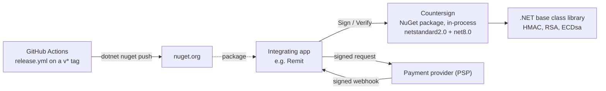
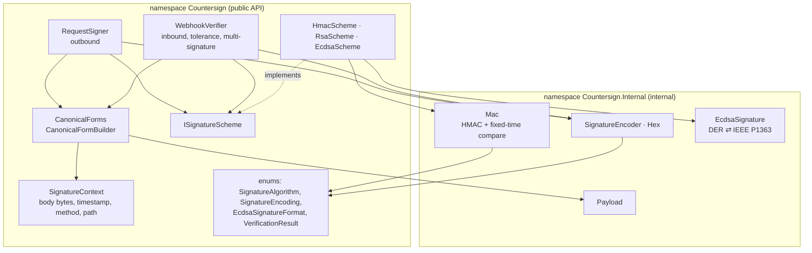
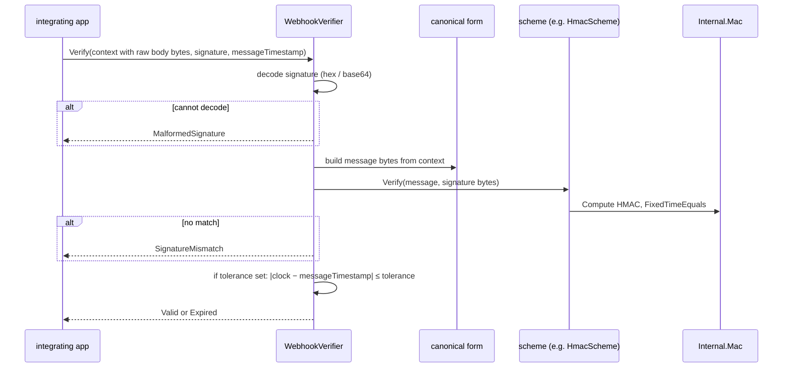
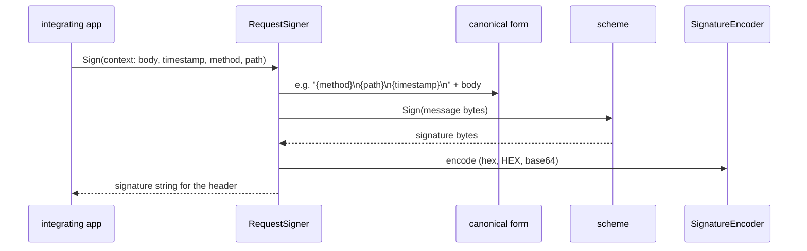
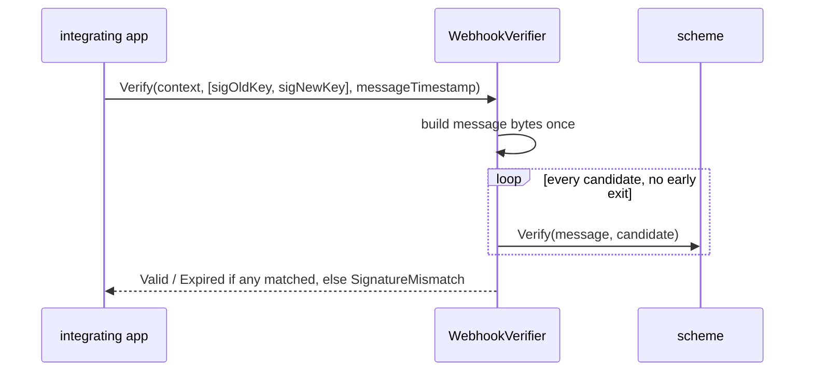
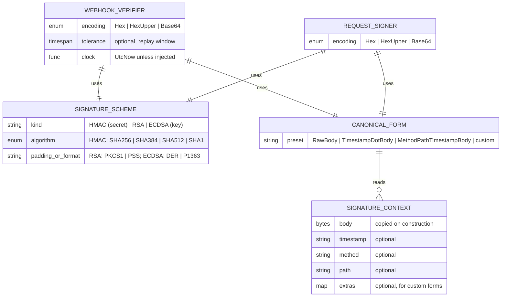

# Architecture — Countersign

Five parts, as the value-al Architecture standard asks. Kept true by the
architecture tests in `tests/Countersign.ArchitectureTests` and by the
reviewer, who fails a PR that changes structure without updating this file.

## 1. System context

Countersign makes no network calls, reads no files and stores nothing. It
gets bytes, secrets or keys, and signatures from the app, and returns a
signature string or a `VerificationResult`. Header parsing, secret storage and
transport security stay with the app (`SECURITY.md`).

## 2. Components and allowed dependencies

Rules enforced by `tests/Countersign.ArchitectureTests`:

- Everything in `Countersign.Internal` is internal, and it never uses
  `RequestSigner`, `WebhookVerifier`, `ISignatureScheme` or a scheme.
- Schemes turn message bytes into signature bytes and back. They never use
  the signer, the verifier, `VerificationResult`, `SignatureContext`,
  canonical forms or encodings: validity is the verifier's decision.
- `RequestSigner` and `WebhookVerifier` never use each other.
- HMAC types and `CryptographicOperations` are used only in `Internal.Mac`,
  so every HMAC check goes through its fixed-time compare.
- Public non-static classes are sealed.
- The assembly references only the base class library.

The public surface itself is pinned by `PublicApiTests` against
`tests/Countersign.Tests/PublicApi.approved.txt`.

## 3. Key flows

**Verifying an inbound webhook**

**Signing an outbound request**

**Key rotation: several candidate signatures**

## 4. Data model

No database: the library keeps no state between calls. These are the
in-memory types a call works with.

## 5. Decision log

| Date | Decision | ADR |
|---|---|---|
| 2026-05-27 | `netstandard2.0` + `net8.0`, no runtime dependencies, BCL crypto only; Ed25519 in a separate package; xUnit with known-answer vectors and a public API snapshot | [ADR-0001](docs/adr/0001-targets-and-dependencies.md) |
| 2026-05-27 | Two types for two directions, bytes in, schemes as plug-ins while the verifier owns the policy | [ADR-0002](docs/adr/0002-two-directions-bytes-in-scheme-plug-in.md) |
